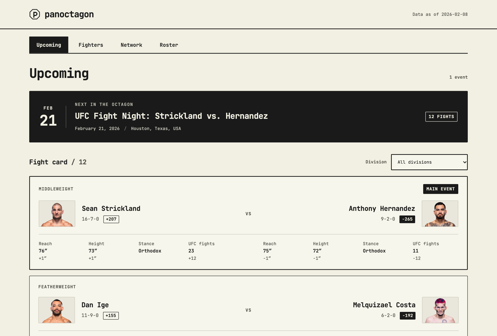
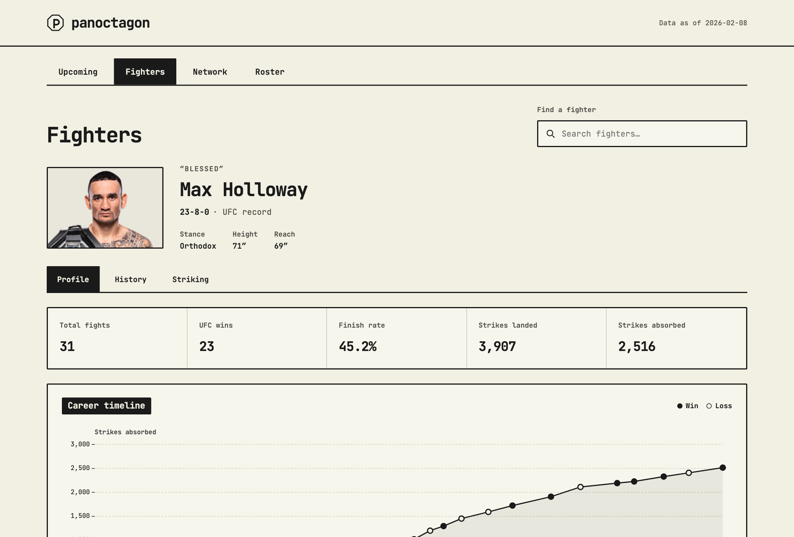
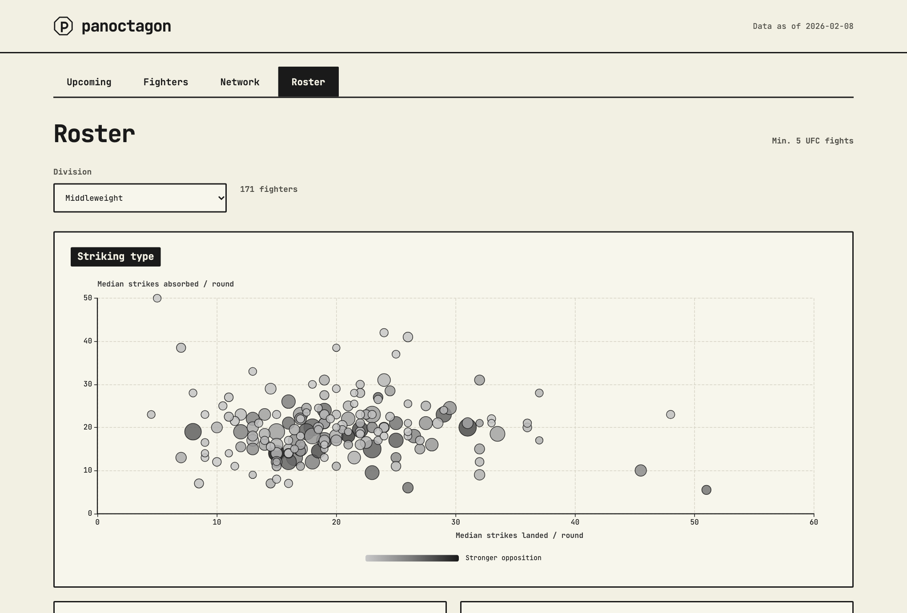

# panoctagon

UFC fight data, stats, and visualizations — live at [panoctagon.jeffbrennan.dev](https://panoctagon.jeffbrennan.dev).

Scrapes UFC Stats and Best Fight Odds on a schedule, crunches everything in DuckDB with Dagster and dbt, and serves a fast Svelte + ECharts dashboard alongside a FastAPI backend and CLI.

## The site

Four main views, built for both desktop and mobile:

### Upcoming
Next UFC card at a glance — head-to-head physical stats, records, reach/height deltas, and closing odds.



### Fighters
Search any UFC fighter for their bio, career timeline, finish breakdown, fight history, and striking charts.



### Network
Interactive matchup graph showing how a division connects over any span of years. Click a fighter to isolate their opponents and pull up head-to-head records.


### Roster
Division-wide striking styles, target distributions, matchup discrepancy trends, and a sortable fighter table.



## API

Served under `/api`, with interactive Swagger docs at `/api/docs`.

| Endpoint | Description |
| --- | --- |
| `GET /fighter` | Search fighters by name or division |
| `GET /fighter/{id}` | Fighter bio, record, and recent fights |
| `GET /fighter/{id}/stats` | Fighter statistics |
| `GET /fighter/{id}/fights` | Fight history |
| `GET /events` | List events |
| `GET /event/{id}` | Event details and fight card |
| `GET /fight/{id}` | Fight details with round-by-round stats |
| `GET /rankings` | Leaderboard by division |
| `GET /roster` | UFC roster with filters |
| `GET /upcoming` | Upcoming events and matchups |
| `GET /divisions` | All divisions |

## CLI

Same data, straight from the terminal:

```sh
panoctagon upcoming
panoctagon fighter "Max Holloway"
panoctagon compare "Max Holloway" "Ilia Topuria"
panoctagon leaderboard
panoctagon event
panoctagon roster
```

## Pipeline

Scraping, parsing, and transformations run through Dagster and dbt into DuckDB. After a clean refresh, the pipeline publishes a read-only snapshot under `data/api_snapshots` so the web/API readers never contend with writes.


## Running locally

The dashboard lives in [`frontend/`](frontend/README.md) (Svelte 5 + TypeScript + ECharts) and is served together with `/api` by FastAPI (`panoctagon.web.server:app`).

```sh
# dev mode (separate terminals, proxies /api automatically)
just api
just web

# or build and serve everything from one process on :8080
just webpreview
```

For frontend checks, Playwright tests, and deployment notes, see [`frontend/README.md`](frontend/README.md) and [`docs/svelte-cutover-runbook.md`](docs/svelte-cutover-runbook.md). To opt into the single-container Svelte + API stack in Docker, layer `docker-compose.svelte.yaml` on top of `docker-compose.yaml`.

## Stack

Svelte 5, TypeScript, ECharts, Python, FastAPI, DuckDB, Dagster, dbt

## Sources

- [ufcstats.com](http://ufcstats.com) — fight stats and results
- [bestfightodds.com](https://www.bestfightodds.com) — betting odds
