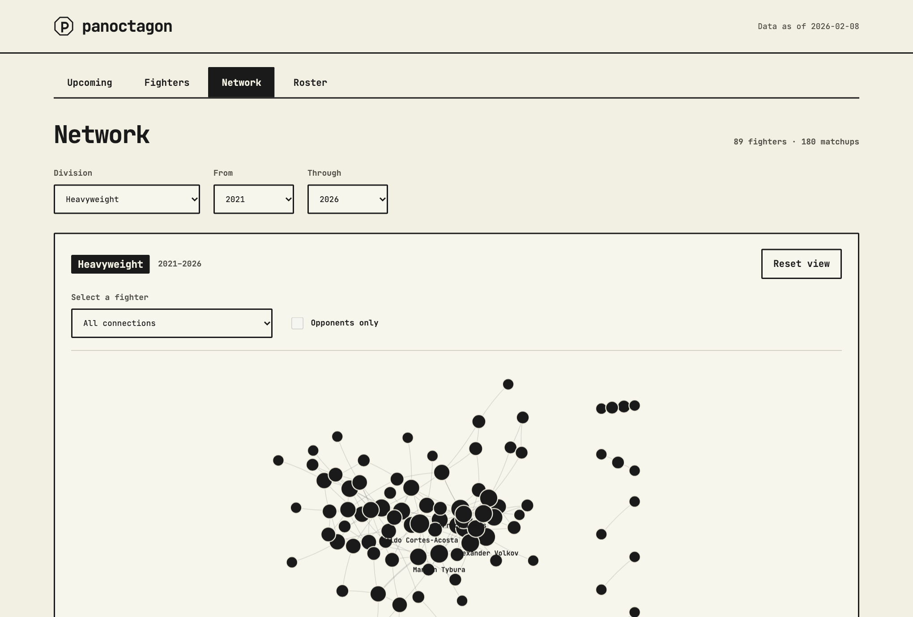
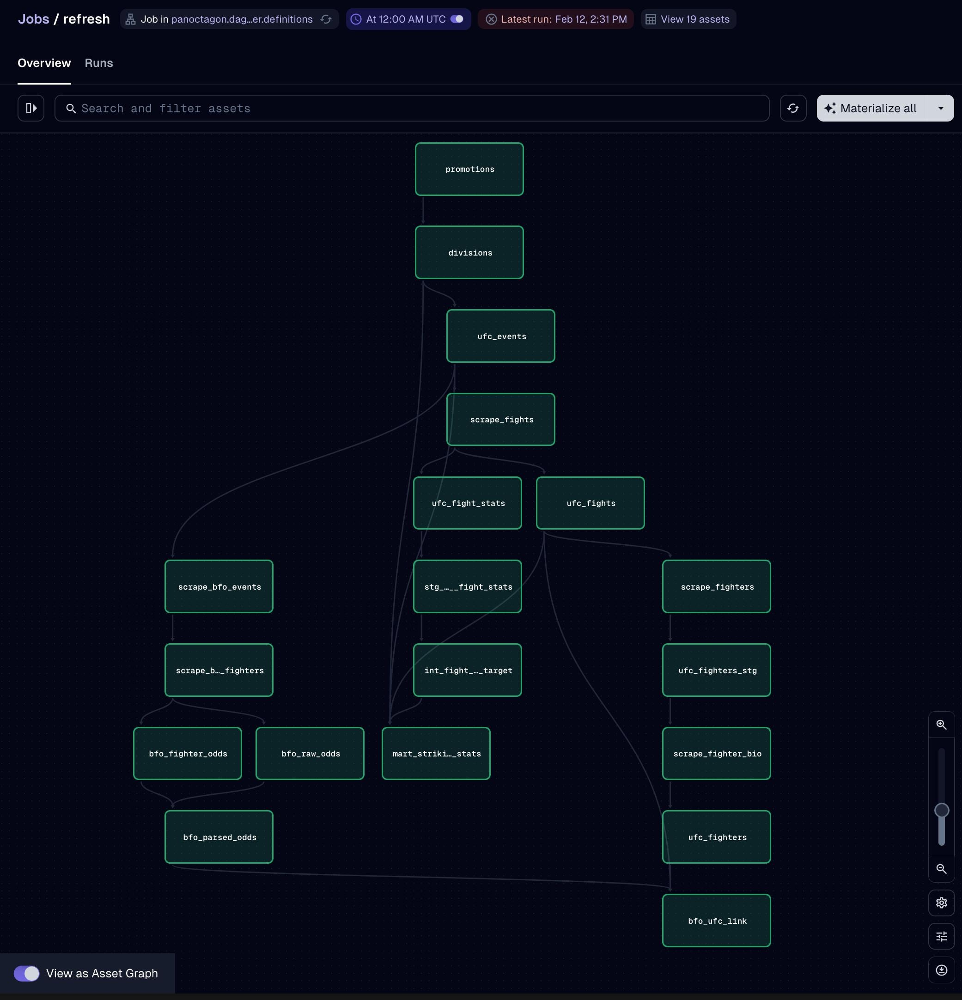

# panoctagon

UFC fight data aggregation, analysis, and visualization

## Local frontend rewrite

A Svelte + ECharts frontend is available in [`frontend/`](frontend/README.md). Run
`just api` and `just web` in separate terminals, then open <http://127.0.0.1:5173>.
It uses the existing local DuckDB data through FastAPI. The production dashboard and
Docker configuration still use Dash while the rewrite is evaluated locally.

Live at [panoctagon.jeffbrennan.dev](https://panoctagon.jeffbrennan.dev)

## Site

The dashboard has four main views:

### Upcoming
Shows upcoming UFC events with fighter matchup comparisons, physical stats, records, and betting odds.

 

### Fighters
Individual fighter profiles with career stats, fight history, and performance breakdowns.

 

### Network
Visual graph of fighter matchup connections.

 

### Roster
Searchable roster with division filtering and stat comparisons.

 

## API

Available at `/api`. Full docs at `/api/docs`.

| Endpoint | Description |
| --- | --- |
| `GET /fighter` | Search fighters by name or division |
| `GET /fighter/{id}` | Fighter bio, record, and recent fights |
| `GET /fighter/{id}/stats` | Fighter statistics |
| `GET /fighter/{id}/fights` | Fight history |
| `GET /events` | List events |
| `GET /event/{id}` | Event details and fight card |
| `GET /fight/{id}` | Fight details with round-by-round stats |
| `GET /rankings` | Leaderboard by division |
| `GET /roster` | UFC roster with filters |
| `GET /upcoming` | Upcoming events and matchups |
| `GET /divisions` | All divisions |

## CLI

The `panoctagon` CLI provides terminal access to the same data.

```
panoctagon upcoming
panoctagon fighter "Max Holloway"
panoctagon compare "Max Holloway" "Ilia Topuria"
panoctagon leaderboard
panoctagon event
panoctagon roster
```

## Pipeline

Data is scraped, parsed, and transformed using Dagster and dbt.

 

## Stack

Python, FastAPI, Dash, DuckDB, Dagster, dbt

## Sources

- [ufcstats.com](http://ufcstats.com) - fight stats and decisions
- [bestfightodds.com](https://www.bestfightodds.com) - betting odds

### Svelte dashboard checks

With Python 3.12.12, Node 26.13.0 and uv installed, run `uv sync --frozen`,
`cd frontend && npm ci`, then `npm run check`, `npm test`, and `npm run build`.
Install browsers with `npx playwright install --with-deps chromium firefox webkit`.
`npx playwright test` runs the fixture-based interaction suite; `npx playwright
test -c playwright.integration.config.ts` runs the built application against an
isolated database under `.scratch/integration`. The integration server requires
port 8765 and never opens the working ingestion database.
